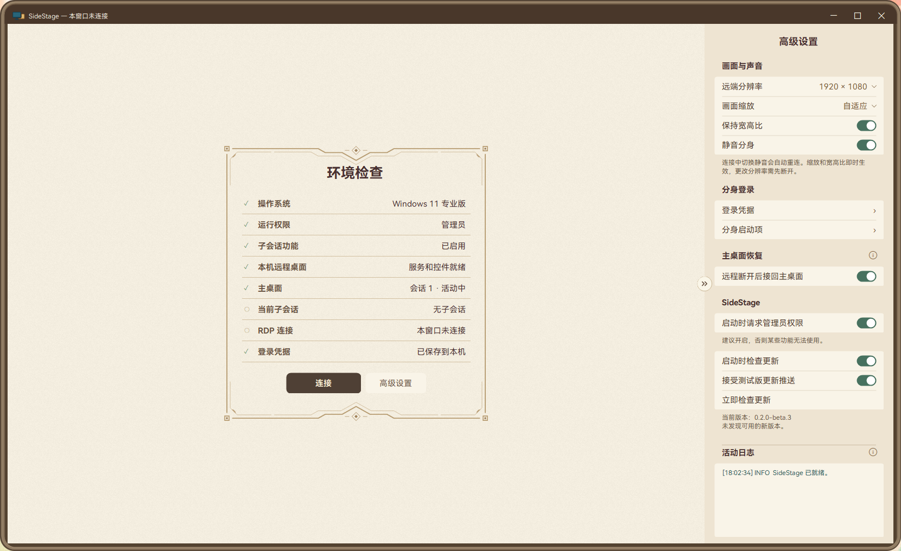

<p align="center">
  
</p>

<h1 align="center">SideStage</h1>

<p align="center"><a href="./README.md">简体中文</a> · English</p>

<p align="center">
  <a href="#download"></a>
  <a href="https://github.com/RayFlows/SideStage/releases"></a>
  <a href="https://github.com/RayFlows/SideStage/releases"></a>
</p>

SideStage uses an RDP loopback connection to display a local Windows child session in a regular window. Simulated input in that window leaves the main desktop's mouse and window focus alone. Scripts and apps that capture windows inside the child session can keep doing so when you turn off the physical monitor.



SideStage is for scripts and apps that run directly on a physical PC and need to capture windows, simulate input, or take control of the mouse or window focus.

## Download

[GitHub Releases](https://github.com/RayFlows/SideStage/releases)

[CNB mirror for China](https://cnb.cool/fouramstage/SideStage)

Installers are available for Windows 10 and 11 x64. Download the file ending in `-Setup-x64.exe`. The installer includes the .NET runtime.

## Usage

SideStage currently supports Windows 10 and 11 x64 in our testing. The app opens on an environment checklist. Opening it reads your system settings. Settings change only when you take an action.

1. **Check that Windows child sessions are enabled.**
   If you see a cross on that row, click the button next to it to enable the feature.
2. **We recommend setting up Login credentials (登录凭据) in SideStage.**
   In our testing, this avoids many Windows sign-in issues. For example, if you sign in with a PIN, you may have to enter it again each time. When you leave credentials unconfigured, SideStage tries to sign in automatically using your current Windows session. This can cause two problems.
   - Automatic sign-in may fail due to Windows settings or your sign-in method, for example if you've changed your RDP settings or use a PIN.
   - You may be unable to run apps as administrator. We suspect the permissions differ between automatic sign-in using the main desktop's identity and sign-in with credentials. See the question about running apps as administrator in the [Q&A](#qa).

Once all the checks pass, you should be able to connect.

**⚠️ Notes**

1. Windows shows a UAC prompt the first time you enable child sessions. SideStage enables the Windows setting for you.
2. Microsoft's documentation lists the Pro, Education, and Pro for Workstations editions for hosting RDP connections. In our testing, Windows Home can also attempt a connection and should work in most cases. Try connecting to see whether it works on your PC.
3. A child session has its own desktop and input, with the same account permissions. It runs directly on your PC. Keep untrusted software out of the session.
4. Changing the resolution requires reconnecting. Toggling Mute child session (静音分身) also reconnects, and programs in the session keep running.

## Q&A

1. **Will the programs in the session close when I close the SideStage window?**\
   Yes. To keep them running, choose Advanced settings → Disconnect (高级设置 → 断开连接). If you click × while connected, check the confirmation dialog. If it asks you to sign out of the child session and you confirm, the programs will close and any unsaved work will be lost. Once disconnected, you can close the window and leave the session running.

2. **Do I have to enter my password every time?**\
   In Login credentials (登录凭据), select Save locally (保存到本机) to save it in the current user's Windows Credential Manager. You should be able to connect without re-entering the password. **Saved credentials stay in Windows Credential Manager after you uninstall SideStage.**

3. **Will the main desktop lock? How many child sessions can I open at once?**\
   The main desktop stays unlocked. Each PC can have one active, connected child session at a time. The child session depends on the main session. Disconnecting SideStage leaves the child session running. **Signing out of your Windows account on the main desktop** ends the child session as well. See Microsoft's [child sessions documentation](https://learn.microsoft.com/zh-cn/windows/win32/termserv/child-sessions).

4. **Can I use Windows Home?**\
   Microsoft's list of [editions that can host a regular Remote Desktop connection](https://learn.microsoft.com/zh-cn/windows-server/remote/remote-desktop-services/remotepc/remote-desktop-allow-access) includes Pro, Enterprise, and Education. SideStage connects to a local child session. On Windows Home, it shows a yellow warning and still lets you try connecting. Whether you can sign in depends on your PC.

5. **Can scripts still capture windows with the monitor off?**\
   They should be able to as long as you stay signed in to the child session.

6. **Why can't I sometimes run a program as administrator in the child session?**\
   In our comparison, Windows returned the logon flags `0x8120` when we signed in with the account password and `0x48120` when we used the main desktop's identity. The extra `0x40000` (`LOGON_NO_ELEVATION`) means elevation was unavailable for that sign-in. We observed these values on the machine we tested. SideStage uses the password you enter for the current connection regardless of the Save locally setting. Saving the password lets you skip entering it again. Your account keeps the same administrator rights.

7. **Where can I find the logs?**\
   Open Advanced settings (高级设置), hover over the information icon beside Activity log (活动日志), and click the blue link in the tooltip.

P.S. Most issues come from Windows itself, and some bugs are in RDP. Feel free to discuss solutions in Issues. BetterGI's desktop clone feature was a major source of inspiration for this project. We built this library because that feature is closely tied to Genshin Impact and BetterGI. You may find solutions in [BetterGI's desktop clone documentation](https://www.bettergi.com/feats/command/session.html) or [the related BetterGI issues](https://github.com/babalae/better-genshin-impact/issues?q=is%3Aissue%20label%3A%E6%A1%8C%E9%9D%A2%E5%88%86%E8%BA%AB).

## Run from source

Install the .NET 10 SDK on Windows x64 and run these commands from the repository root. `global.json` specifies `10.0.400` as the starting version and also allows newer SDKs in the `10.0` series. You can run these three commands without installing PowerShell 7 separately.

```powershell
dotnet build SideStage.slnx -c Release
dotnet test  SideStage.slnx -c Release --no-build
dotnet run --project src/SideStage.App -c Release --no-build
```
