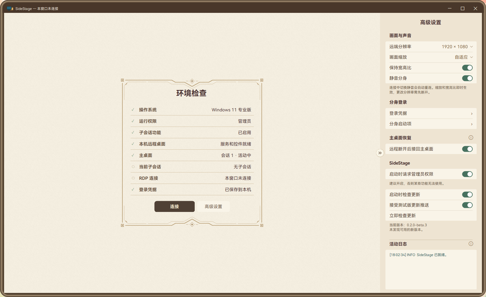
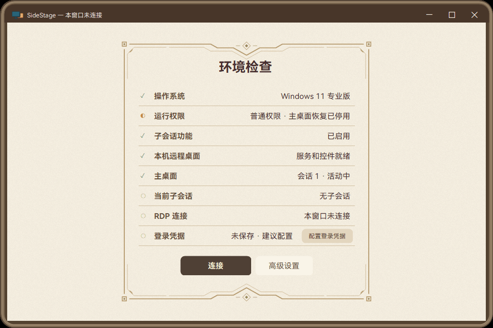

<p align="center">
  
</p>

<h1 align="center">SideStage</h1>

<p align="center">简体中文 · <a href="./README.en.md">English</a></p>

<p align="center">
  <a href="#下载"></a>
  <a href="https://github.com/RayFlows/SideStage/releases"></a>
  <a href="https://github.com/RayFlows/SideStage/releases"></a>
</p>
<p align="center">⭐ 喜欢项目的话，感谢您点一个Star啦~ 您也可以收到更新通知哦~</p>

利用RDP回环连接，把本机的 Windows 子会话连进一个普通窗口，此时该窗口的模拟输入事件将不会再影响主桌面的输入（也就是不抢鼠标和窗口聚焦了），同时关闭物理显示器之后也不会再影响在子会话中进行窗口捕捉的脚本与应用。



本项目旨在解决某些脚本/应用不使用虚拟机，而是直接使用物理机进行窗口捕捉/模拟输入等需要“抢鼠标”或者窗口聚焦操作的问题。



## 具体能解决什么问题？

1. **脚本要用鼠标和键盘，您还想继续用电脑。** 把脚本和它要操作的程序一起放进子会话。脚本可以在里面点击、打字、切换窗口，您可以在主桌面继续工作。
2. **每次连接都要重新输入密码。** 可以为子会话配置 Windows 账户密码。凭据仅保存在本机的 Windows 凭据管理器，下次连接时可自动使用，主桌面仍然可以用其他方式登录。（\*初步测试结果）
3. **在子会话里，有时无法以管理员身份打开应用。** 部分设备在沿用主桌面登录身份时会遇到这个问题。可以改用 Windows 账户密码重新建立子会话，再按正常流程确认管理员权限。
4. **从另一台电脑断开远程桌面后，子会话里的程序还在跑，脚本的点击和按键却失效了。** 如果主会话仍在运行，SideStage 会尝试把它接回本机控制台，恢复子会话里的鼠标和键盘输入。（\*这项实验性功能需要管理员权限。接回后，本机屏幕可能显示主桌面）
5. **主桌面已经启动的软件，登录子会话时又开了一遍。** 在启动项设置里，可以逐项选择哪些程序在登录子会话时跳过，也可以批量开关。主桌面仍按原有设置启动。（\*此功能从 `v0.2.0` 开始提供）
6. **想更新 SideStage 或暂时断开连接，但子会话里的任务还没跑完。** 选择「断开连接」可以保留子会话和其中运行的程序，下次连接时继续查看进度。需要结束里面的程序时，再选择「注销子会话」。
7. **脚本需要固定分辨率，但子会话窗口太占地方。** 可以让子会话保持在脚本需要的分辨率（如 `1920 × 1080`），同时让画面按比例缩放到较小的窗口。也可以单独将子会话静音，主桌面的声音照常播放。
8. **Codex 等 AI 工具的 Computer Use 功能会占用鼠标和浏览器。** 把这些工具和它们操作的浏览器放进子会话，您可以继续使用主桌面的鼠标和浏览器。

## 下载

[GitHub Releases](https://github.com/RayFlows/SideStage/releases) 

[CNB 国内源](https://cnb.cool/fouramstage/SideStage)

目前提供 Windows 10 / 11 x64 安装包，下载文件名以 `-Setup-x64.exe` 结尾的安装程序即可（不需要单独装.NET）。

## 使用方法

\*目前仅支持 Windows 10/11 x64

应用打开是环境检查表，仅读取本机情况，除非您触发操作，否则SideStage不会尝试主动修改任何设置。

1. **先检查环境检查表，确认您的子会话功能已经打开。**
   如果您没发现环境检查表是打叉的，点击旁边按钮也可以一键打开。
2. **我们非常建议您自己在SideStage配置一下“登录凭据”**
   根据测试能避免很多Windows登录凭据多所引起的bug（比如如果您使用PIN登录，那么您每次都需要重新输入您的PIN）。您可以选择不配置，SideStage会尝试走Windows的本会话自动登录，它会一般带来两个问题：
   - 您没办法自动登录，这一般是Windows自己的问题，包括但不仅限于您曾经改过RDP设置/您尝试使用PIN或其他方式进行的登录等。
   - 您无法在进入之后使用管理员权限打开应用，目前据推测是因为自动登录（沿主桌面身份登录）和凭据登录会导致权限不同，详见Q&A（为什么有时在子会话里不能「以管理员身份运行」？）。

以上检查无误都打勾之后，您应该可以正常进行连接。

**⚠️ 注意：**

1. 「子会话功能」第一次可能要过一次 UAC。开关在 Windows 里，SideStage 只是替你点了一下。
2. 照Windows官方文档所说，仅专业版/教育版/专业工作站版支持成为RDP的被控端，但根据我们测试家庭版可以进行尝试，大部分应该可以登录，故能不能登进去以实际连接为准。
3. SideStage隔开的是桌面和输入，不是权限。它**并非虚拟机**，**千万不要拿它当沙箱跑来路不明的东西**。
4. 改分辨率要断开重连；切「静音子会话」会重连一次，里面的程序不受影响。

## Q&A

1. **Q：关掉窗口，里面的程序会没吗？**\
   **A：** 会。想保留里面的程序，选「高级设置 → 断开连接」。连接中点 × 时，请看确认框：如果提示‘注销子会话’，确认后程序会结束，未保存的工作会丢失。已经断开后再关窗口，不会注销。

2. **Q：每次都要输密码？**\
   **A：** 在「登录凭据」里勾「保存到本机」，存进当前用户的 Windows 凭据管理器，若您进行了本操作，应该不需要您输入密码，但**卸载 SideStage 不会删除已经存在的凭据**。

3. **Q：主桌面会被锁吗？能同时开几个子会话？**\
   **A：** 不会。连接本机子会话不会因为这次连接而锁住主桌面。同一台电脑同一时间只能有一个处于活动且已连接状态的子会话。它依附于主会话：断开 SideStage 不等于注销，但如果你**注销主桌面上的 Windows 账户**，子会话也会结束。见微软的[子会话说明](https://learn.microsoft.com/zh-cn/windows/win32/termserv/child-sessions)。

4. **Q：Windows 家庭版能用吗？**\
   **A：** 微软[列出的普通远程桌面主机版本](https://learn.microsoft.com/zh-cn/windows-server/remote/remote-desktop-services/remotepc/remote-desktop-allow-access)包括专业版、企业版和教育版，不包括家庭版。SideStage 连接的是本机子会话：家庭版会显示黄色提示，但不会仅因为版本就禁止连接。能否登录，以这台电脑上的实际结果为准。

5. **Q：关掉显示器，脚本还能截图吗？**\
   **A：** 应该可以，只要您不**注销**子会话。

6. **Q：为什么有时在子会话里不能右键「以管理员身份运行」？**\
   **A：** 在我们的对照测试中，使用账户密码时，Windows 返回的登录标志是 `0x8120`；沿用主桌面身份时是 `0x48120`，多出的 `0x40000`（`LOGON_NO_ELEVATION`）表示那次登录不允许提权。（注：这只是特定机器的观测结果）这并不是「登录凭据」-「保存到本机」开关决定的：当前界面即使不保存，也会使用这一次输入的账户密码。保存密码只是免去重复输入，不会给账户自己增加管理员权限。对了顺便提一嘴，跳让您输入密码的窗口一般是您自己保存凭据的时候密码输错了，再输入保存一次一般就行了。

7. **Q：日志在哪里？**\
   **A：** 「高级设置」-「活动日志」旁边有一个类似“i”的东西，鼠标放上去点里面气泡的蓝链即可。

（PS：问题一般出在Windows自己身上，有些BUG是RDP自带的，欢迎大家在issue里留言讨论解决方案。本项目其实有很大一部分动力与灵感来自[BetterGI](https://github.com/babalae/better-genshin-impact)的桌面分身，但我们发现BetterGI的桌面分身主要耦合在了原神和BetterGI自身上，且如果只把它当作桌面分身来用不太好用，所以才有这个自实现库，故有一些问题也许在[BetterGI的桌面分身文档](https://www.bettergi.com/feats/command/session.html)或[BetterGI的相关issue](https://github.com/babalae/better-genshin-impact/issues?q=is%3Aissue%20label%3A%E6%A1%8C%E9%9D%A2%E5%88%86%E8%BA%AB)能找到解决方案，可以进行参考【感谢一下BetterGI的开发组，脚本tql太好用了】）

## 源码运行

在 Windows x64 上安装 .NET 10 SDK，在仓库根目录执行以下命令。`global.json` 指定的起始版本是 `10.0.400`，也允许同一 `10.0` 系列中更新的 SDK。只运行下面三条命令不需要额外安装 PowerShell 7。

```powershell
dotnet build SideStage.slnx -c Release
dotnet test  SideStage.slnx -c Release --no-build
dotnet run --project src/SideStage.App -c Release --no-build
```
